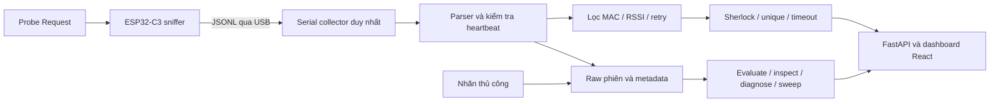

# Đặc tả dự án WiFi Device Sherlock

Phiên bản tài liệu: 1.0 · Cập nhật 17/11/2026. Mô tả triển khai trong repository tại thời điểm cập nhật, thay cho các đặc tả nháp trước. Hướng dẫn chạy nằm trong [README.md](README.md).

## 1. Phạm vi và đầu ra

Hệ thống dùng **một ESP32-C3 sniffer + laptop** để thu Probe Request WiFi 2.4 GHz thụ động và chạy Sherlock adaptation. Đầu ra trực tiếp là số nguồn MAC đang duy trì xác nhận quan sát, không phải danh tính thiết bị hay số người chính xác.

Đã có: thu serial và tự nối lại, kiểm tra heartbeat, lọc nguồn/RSSI/retry, ba thuật toán đếm, dashboard, ghi phiên/nhãn, replay, đánh giá, heatmap, sweep tham số và chẩn đoán MAC.

Chưa triển khai: CSI/TX-RX sensing, mô hình học máy phát hiện người, băm MAC trước ghi đĩa, hợp nhất MAC ngẫu nhiên, nhận dạng thiết bị vật lý, CSV `probe.csv`/`data/device/<session_id>.csv` theo bản nháp cũ, quét danh sách client của router. Các định dạng BOOT/PRB/STAT dạng CSV của nháp cũ không phải đầu vào parser hiện tại.

## 2. Kiến trúc



Backend bind `127.0.0.1`; không có xác thực nhiều người dùng. Polling giao diện không quyết định nhịp thu serial. Một radio chỉ nghe một kênh tại mỗi thời điểm.

## 3. Firmware và serial

Firmware: `firmware/sniffer`, ESP-IDF 5.5.4, ESP32-C3. UART0 GPIO21 TX / GPIO20 RX, 460800 baud cho cấu hình board CH340 hiện có. JSON UTF-8, mỗi dòng một object kết thúc bằng newline. Boot log/dòng sai bị bỏ qua và tăng bộ đếm lỗi parser.

Mặc định country VN, hopping kênh 1–13, dwell 3000 ms/kênh. Một vòng danh nghĩa 39 giây, không tính trễ. Có cấu hình fixed channel qua menuconfig. Chọn kênh phù hợp country policy; đổi cấu hình radio cần build/flash lại.

Callback chỉ lấy management Probe Request, bỏ gói ngắn/lỗi và nguồn trùng MAC board, sao chép thông tin cần thiết vào queue 128 phần tử. Task riêng xuất serial, heartbeat khoảng mỗi giây và đổi kênh. Queue đầy tăng `probe_dropped`.

### Trường chung

| Trường | Kiểu / ý nghĩa |
|---|---|
| v | Integer, bằng 1 |
| type | probe, status hoặc channel |
| node | Chuỗi sniffer |
| boot_id | Chuỗi không rỗng, tối đa 40 ký tự; thay đổi khi board khởi động |
| ts_us | Integer ≥ 0, micro giây từ boot |
| seq | Integer ≥ 0, thứ tự packet xuất serial |

`seq` không phải bộ đếm gói của riêng một thiết bị. `ts_us` không phải thời gian UTC. MAC được parser chuẩn hóa chữ thường dạng `aa:bb:cc:dd:ee:ff`.

### Packet probe

| Trường bổ sung | Ràng buộc / ý nghĩa |
|---|---|
| source_mac | MAC nguồn Address 2 |
| rssi | Integer từ −127 đến 0 dBm |
| channel | Integer 1–13 tại thời điểm nhận gói |
| frame_seq | Integer 0–4095, sequence number của frame |
| retry | Boolean, mặc định false nếu thiếu |
| ie | Chuỗi `mã:độ dài` của các Information Element theo thứ tự trong khung, ví dụ `0:0,1:4,50:8,45:26`; rỗng nếu firmware cũ |

```json
{"v":1,"type":"probe","node":"sniffer","boot_id":"boot-a","ts_us":1234567,"seq":12,"source_mac":"9a:31:87:22:fd:08","rssi":-67,"channel":6,"frame_seq":88,"retry":false}
```

Kênh trong Probe là kênh nhận thực tế. Probe nằm trong queue có thể được xuất sau sự kiện đổi kênh, không suy ra kênh từ thứ tự dòng serial.

### Packet status

| Trường bổ sung | Ý nghĩa |
|---|---|
| capture_active, sniffer_enabled | Boolean trạng thái radio |
| own_mac | MAC STA của sniffer, tự đưa vào danh sách loại trừ |
| channel, scan_mode, dwell_ms | Kênh 1–13, fixed/hopping, dwell 100–10000 ms |
| probe_seen, probe_dropped | Tổng Probe board ghi nhận / rơi do queue |
| invalid | Bộ đếm khung lỗi/ngắn trên board |
| serial_errors, bytes_written | Bộ đếm lỗi xuất serial / byte ghi |
| serial_baud | 460800 |

Các bộ đếm board là tích lũy từ boot, không phải tốc độ mỗi giây và không cùng mốc với bộ đếm thuật toán trên laptop.

### Packet channel

Thêm `channel` (1–13), `dwell_ms` (100–10000); `ts_us` ghi sau thao tác chuyển kênh. Schema máy đọc giữ tại [docs/packet.schema.json](docs/packet.schema.json); parser thực thi nằm trong `backend/app/protocol.py`.

## 4. Thu, chất lượng dữ liệu và lọc

Collector là tiến trình duy nhất sở hữu serial; gặp lỗi sẽ tự nối lại. Buffer dòng được giới hạn. `counters.valid` là số packet parse hợp lệ, gồm status/channel/probe; không đồng nghĩa số Probe hay số MAC. `counters.invalid` là số dòng sai; `bytes`, `reconnects` theo dõi byte vào và lần lỗi nối lại.

Nguồn hợp lệ cần connection connected và heartbeat còn hạn, radio active/sniffer enabled. Mặc định quá 5 giây không có heartbeat thì `valid=false`, `result=null`; giao diện hiển thị `—`. Không trả số 0 thay cho thiếu dữ liệu.

Boot mới, control reconnect hoặc heartbeat quay lại sau gap dài sẽ reset suy luận; cần xác nhận lại. Hết replay đặt nguồn finished, không kéo dài suy luận để giả thiết bị đã đi.

Thứ tự xử lý Probe: kiểm tra heartbeat → MAC loại trừ → RSSI → giới hạn nguồn → retry trùng → thuật toán. Chỉ triệt retry khi retry=true và cùng MAC/channel/frame_seq trong dưới 100 ms. Không dùng frame_seq để ghép danh tính.

`rssi_min=-127` là không cắt bổ sung trong dải parser; RSSI là mở rộng tùy chọn, không phải ranh giới phòng. Cùng bộ lọc áp dụng cho cả ba thuật toán. Raw phiên giữ cả gói bị bộ lọc loại nếu packet parse hợp lệ.

`recent_sources` là tối đa 50 MAC quan sát gần nhất từ bộ đệm audit, gồm cả gói bị loại và gói thiếu heartbeat; mỗi hàng có MAC, RSSI, age_s, last_seen_s, last_reason. Không phải danh sách mọi thiết bị xung quanh.

## 5. Sherlock adaptation

Phiên bản thuật toán: `sherlock-repo-slots-v2`, lấy cảm hứng từ Oliveira et al., *Mobile Device Detection Through WiFi Probe Request Analysis* (2019), DOI 10.1109/ACCESS.2019.2925406. Đây là triển khai adaptation độc lập, không tuyên bố tái lập đầy đủ prototype đa giao diện hoặc đạt kết quả bài báo.

Khe là `floor(elapsed_s / slot_s)`, chốt tại cuối khe. Trong một khe, một MAC chỉ đóng góp một lần có/không có Probe, dù có nhiều gói.

| Trạng thái | Quan sát khi chốt khe | Chuyển đổi |
|---|---|---|
| Chưa theo dõi | Có Probe | Tạo candidate, AT=1; đủ ngưỡng thì xác nhận |
| candidate | Có Probe | Tăng số khe dương, WT về 0; đủ AT → present |
| candidate | Không Probe | Tăng WT; đủ khe trống liên tiếp → hủy ứng viên |
| present | Khe trống đầu | departing, DT=1; nếu ngưỡng DT=1 thì hết hiệu lực ngay |
| departing | Có Probe | Về present, DT về 0 |
| departing | Không Probe | Tăng DT; đủ ngưỡng → hết hiệu lực xác nhận |

AT tích lũy số khe dương; một khe trống chưa đủ WT không tự xóa tiến độ AT. Tổng `count` gồm cả present và departing. “Thiếu quan sát” không chứng minh thiết bị rời phòng.

Ví dụ slot=10 s, AT=2: Probe lúc 1 s và 11 s → xác nhận lúc 20 s. Nếu DT=2 và không có gói tiếp, 30 s chuyển departing, 40 s hết hiệu lực. Không ghi lùi thời điểm xác nhận về gói đầu.

`n_sources_seen` là số MAC khác nhau đã qua lọc trong **khe đang mở**, chưa chốt. `sources` là tracks sau chốt khe, có state, RSSI gần nhất, age_s, positive_slots, missing_slots, departure_slots và các mốc xác nhận. Không đồng nhất bảng Probe vừa nhận với bảng tracks.

Đối chứng:

- **Unique:** số MAC có gói trong cửa sổ trượt `unique_window_s`, không phải số MAC trong khe Sherlock.
- **Timeout:** đủ `confirm_hits` trong `confirm_window_s`, duy trì xác nhận tối đa `timeout_s` từ gói cuối.

## 6. Cấu hình

File đang nạp mặc định: `configs/probe.json`. Giá trị thực tại thời điểm cập nhật:

| Khóa | Hiện tại | Ý nghĩa |
|---|---|---|
| slot_s | 60 | Độ dài khe giây |
| arrival_slots | 2 | AT |
| withdrawal_slots | 2 | WT |
| departure_slots | 3 | DT |
| rssi_min | −127 | Tắt cắt RSSI bổ sung |
| unique_window_s | 60 | Cửa sổ unique |
| timeout_s | 120 | Hết hạn timeout |
| confirm_window_s | 30 | Cửa sổ xác nhận timeout |
| confirm_hits | 2 | Số gói xác nhận timeout |
| heartbeat_s | 5 | Hạn heartbeat |
| max_sources | 2000 | Giới hạn nguồn |
| excluded_macs | [] | MAC loại trừ thủ công; MAC board được bổ sung trong bộ nhớ |

Mặc định trong lớp `ProbeConfig` và `configs/reference.json` dùng 60 giây, 6/2/6; không nhầm với cấu hình thử hiện tại. Thay đổi trên dashboard được lưu xuống file. Demo nhanh dùng 5 giây, 2/2/2; preset thử nhanh dùng 15 giây, 2/2/2.

Sửa toàn bộ cấu hình cần idle và không ghi phiên. RSSI có API riêng cho idle/serial; khi đang ghi phải chọn tách phiên và có nguồn hợp lệ, lưu phiên cũ rồi bắt đầu phiên mới với nhãn/phòng được giữ. Đổi RSSI reset suy luận và bộ đếm lọc.

Biến môi trường: `WIFI_PROBE_CONFIG`, `WIFI_PROBE_DATA_DIR` được backend đọc từ môi trường hoặc `.env`; `WIFI_PORT` được script Bash đọc từ môi trường shell. Muốn đổi cổng chạy `WIFI_PORT=8001 bash run.sh`, không chỉ sửa `.env` rồi kỳ vọng shell tự đọc.

## 7. Lưu phiên và nhãn

```text
data/runtime/
  metadata.sqlite3
  experiments/<id>/
    metadata.json
    raw.jsonl
    truth.jsonl
    algorithm-events.jsonl
    markers.jsonl                 # khi có dấu mốc
    evaluation/                  # sau evaluate
      report.json
      timeline.csv
      algorithm-events.jsonl
    inspection/                  # sau inspect
      summary.json
      probe-slots.csv
      probe-heatmap.svg
    diagnosis/                   # sau diagnose
      report.json
      probe-trace.csv
```

`id` là UUID hex, không phải tên ngày/giờ. Bắt đầu phiên tạo lại stream và gốc thời gian của phiên; không kế thừa xác nhận đã tích lũy trước khi ghi.

### raw.jsonl

Mỗi dòng packet có wrapper `packet`, `host_time` (UTC ISO8601), `host_elapsed_s` (giây monotonic từ đầu phiên), `source="serial"`. Packet bên trong giữ đồng hồ boot. Ví dụ:

```json
{"packet":{"v":1,"type":"probe","node":"sniffer","boot_id":"boot-a","ts_us":1234567,"seq":12,"source_mac":"9a:31:87:22:fd:08","rssi":-67,"channel":6,"frame_seq":88,"retry":false},"host_time":"2026-11-17T03:00:01+00:00","host_elapsed_s":1.0,"source":"serial"}
```

Dòng điều khiển laptop thay `packet` bằng `control:{"kind":"serial_connected"}` hoặc serial_disconnected/session_stopped, cùng thời gian host. Không giả đó là packet board. Dòng serial parse lỗi không được ghi vào raw phiên; có bộ đếm lỗi toàn collector.

MAC lưu đầy đủ, chưa băm hoặc ẩn danh. Không có salt hay `mac_hash` trong hợp đồng dữ liệu hiện tại.

### truth.jsonl và metadata.json

Nhãn là giá trị tuyệt đối, giữ hiệu lực đến nhãn tiếp theo:

```json
{"t_s":0.0,"host_time":"2026-11-17T03:00:00+00:00","device_count":2,"people_count":1,"notes":"Hai điện thoại, WiFi bật"}
```

`device_count`: 0–200; `people_count`: null hoặc 0–200, không tự suy ra từ số MAC. Nhãn đầu ghi lúc bắt đầu phiên; nhãn sau chỉ ghi khi người dùng gửi. Không tự cộng/trừ theo phím COUNT của nháp cũ.

Metadata có id, started_at/ended_at, records, synthetic, algorithm_version, config, firmware heartbeat đầu phiên, layout, devices, notes, device_count/people_count ban đầu; khi kết thúc thêm duration_s. Nhãn mới nằm ở truth, không ghi đè số ban đầu trong metadata. Phiên chưa ended_at không được replay/evaluate/tải file qua API.

Markers gồm t_s, host_time, kind, mac tùy chọn và notes. Kind được hỗ trợ: ap_disconnect, ap_connect, scan_requested, screen_lock, screen_unlock, note. Dấu mốc không tự đổi nhãn thiết bị.

## 8. Dashboard

| Khu vực | Nội dung / thao tác |
|---|---|
| Thanh trạng thái chung | Nguồn trực tiếp/phát lại/mô phỏng, kết nối, lỗi, trạng thái ghi |
| Số chính | Tổng nguồn xác nhận, nhãn thiết bị đã lưu, chênh lệch khi thu thật |
| Kết nối & quan sát | USB, demo, phòng, RSSI, preset thời gian, heartbeat/kênh/lỗi, Probe trước lọc và lý do xử lý, tracks có tìm kiếm/lọc trạng thái |
| Ghi phiên & nhãn | Thiết bị thật, số người riêng, mô tả/ghi chú, bắt đầu, ghi số mới, kết thúc |
| Kết quả đã lưu | Danh sách phiên, đánh giá ba thuật toán, tải raw/nhãn/metadata/report/timeline, tạo heatmap/bảng khe |
| Nâng cao | Replay, cấu hình đầy đủ, chẩn đoán một MAC, dấu mốc, journal, các công cụ phân tích |

Không tự bật dữ liệu giả khi chưa kết nối. Demo phải được người dùng bấm và luôn có nhãn mô phỏng. Không dùng 0 thay cho kết quả chưa hợp lệ. Bảng trước lọc có thể giữ quan sát cũ khi nguồn mất, khi đó phải đọc tuổi gói và trạng thái nguồn.

## 9. API cục bộ

Tiền tố `/api/probe` trừ health/ports; OpenAPI đầy đủ tại `/docs` khi server chạy.

| Method | Đường dẫn | Mục đích |
|---|---|---|
| GET | /api/health, /api/ports | Sức khỏe backend / cổng serial |
| GET | /state, /config, /sessions, /replays | Snapshot, cấu hình, phiên, nguồn replay |
| PUT | /config | Ghi toàn bộ cấu hình khi idle |
| PUT | /rssi | rssi_min và split_session |
| POST | /connect, /disconnect | port + baud / ngắt nguồn |
| POST | /replay | name + speed (0.25–100×) |
| POST | /sessions/start, /sessions/stop | Bắt đầu bằng thông tin phiên / kết thúc |
| POST | /truth | Ghi device_count, people_count, notes |
| POST | /markers | Ghi mốc thao tác của phiên serial |
| GET | /diagnostics?mac=... | Quan sát và lý do xử lý MAC |
| POST | /sessions/{id}/evaluate | Tính báo cáo, timeline |
| POST | /sessions/{id}/inspect | Heatmap và thống kê quan sát |
| POST | /sessions/{id}/diagnose | Phân tích MAC truyền trong body |
| GET | /sessions/{id}/files/{kind} | Tải file đã sinh của phiên kết thúc |

Các đường dẫn ngắn trong bảng thuộc `/api/probe`. File kind: raw, truth, metadata, report, timeline, heatmap, slots, inspection, events, live-events, markers, diagnosis, probe-trace. File chưa sinh trả 404. Không cho đổi nguồn khi đang ghi phiên. Không cho phiên chưa kết thúc qua các bước phân tích/tải yêu cầu ended_at.

`state` gồm mode, connection, valid, error, heartbeat_age_s, result, firmware, counters, config, session, current_truth, history, channels, algorithm_version, events, quality, recent_sources, channel_observation_s và semantics. Result gồm unique_count, timeout_count, sherlock, accepted, duplicates, filter_counts, capacity_drops. History có tối đa 180 mẫu đếm gần nhất; không phải lịch sử đầy đủ của phiên.

## 10. Đánh giá và đầu ra offline

Evaluate đọc raw theo host_elapsed_s, chạy stream bằng đồng hồ dữ liệu, ghép nhãn dạng bậc thang. Timeline được lấy mẫu bước 1 giây với cột `t_s,valid,unique,timeout,sherlock,truth`. Không phải CSV sáu cột theo khe một phút của nháp cũ.

Report ghi phiên bản thuật toán, cấu hình, số dòng raw/parse/bỏ qua, coverage, điểm từng thuật toán và sự kiện đổi nhãn. Coverage là tỷ lệ **mẫu timeline** có nguồn và nhãn hợp lệ trên tổng mẫu, không phải tỷ lệ bắt được tất cả gói RF.

| Chỉ số | Ý nghĩa |
|---|---|
| MAE | Trung bình sai số tuyệt đối so với device_count |
| Bias | Trung bình dự đoán trừ nhãn |
| exact_rate | Tỷ lệ mẫu đếm đúng nhãn |
| PCC | Tương quan, null nếu chuỗi hằng/không đủ mẫu; không phải accuracy |
| mre_nonzero | Sai số tương đối trung bình chỉ với nhãn > 0 |
| zero_truth_mae | MAE riêng đoạn nhãn 0 |
| delay_s, censored | Thời gian lần đầu chạm/vượt mức đếm mới trước nhãn kế tiếp; chưa đạt thì censored |

Độ trễ là độ trễ số đếm, không nhận dạng từng máy; đếm dư có sẵn có thể tạo trễ 0. Không bỏ sự kiện censored khỏi báo cáo. Khi không có mẫu hợp lệ, điểm có thể chỉ chứa n=0.

Inspect tạo bảng số Probe theo MAC/khe và heatmap SVG; mặc định khe inspect 60 giây. Đây là thống kê quan sát riêng, không phải đầu ra Sherlock theo hợp đồng nháp. Các nhãn MAC rút gọn trong heatmap không thay raw. Khoảng gián đoạn quan sát có thể do radio nghe kênh khác.

Sweep dùng split development/test độc lập, chọn tham số trên development rồi đánh giá test. Dữ liệu mô phỏng chỉ kiểm tra phần mềm, không chứng minh chất lượng đếm thiết bị thật.

## 11. Giới hạn và xác minh

MAC ngẫu nhiên có thể gây thiếu/đếm dư, điện thoại phát Probe thưa có thể không đủ AT. Thiết bị đang kết nối WiFi không chắc phát Probe trong thời gian thu. RSSI không phân định phòng chính xác; nguồn phòng bên có thể được xác nhận. Không tự đồng nhất thiết bị, MAC và người.

Kiểm tra bằng build frontend, kiểm thử parser/state machine/stream/API và phiên thu có nhãn. Các kiểm thử phần mềm đã chạy hoặc manifest firmware trước đây không thay thế xác minh trên board thực tế. Tài liệu này không cam kết độ chính xác hoặc thời gian phát hiện cố định.
