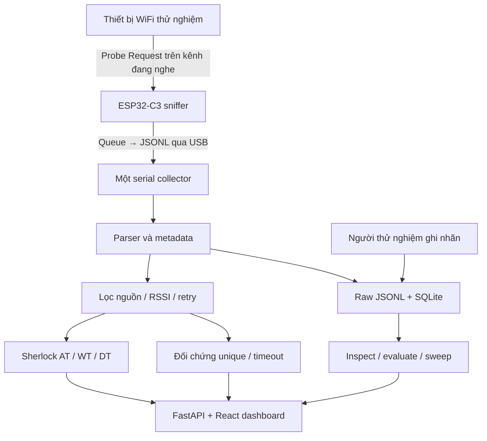

# Kiến trúc nhánh thiết bị

Không có đường truyền TX/RX sensing. Board không tạo AP và không liên kết AP.
Sniffer chỉ theo dõi một kênh tại mỗi thời điểm; hopping tạo các khoảng không
quan sát các kênh khác. Kết quả là thống kê quan sát và suy luận thời gian.

Ba thuật toán dùng cùng một chuỗi quan sát đã lọc. Thiếu heartbeat -> result=null,
không biểu diễn như count0. Dashboard polling mỗi giây không quyết định thời gian
thu serial; offline chạy theo đồng hồ file để có đánh giá tái lập được.
