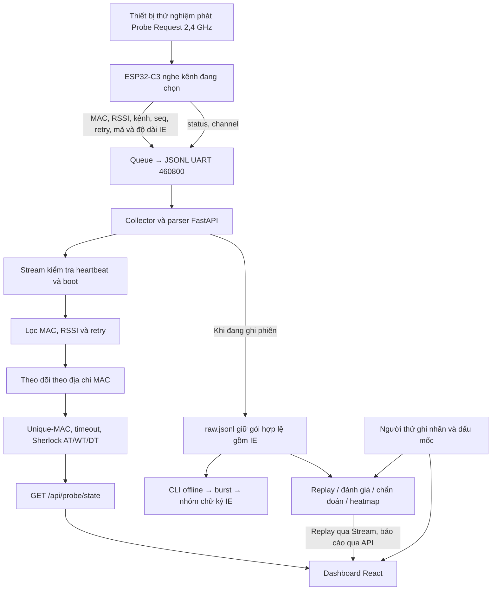

# Audit hệ thống WiFi Device Sherlock

## Phạm vi và cây làm việc

Rà soát ngày **20/11/2026** trên nhánh `feature/probe-ie-fingerprint`. HEAD là `101e8da96271565a8e727bbd720613d9af7aadae`, khớp với ref upstream **đang lưu cục bộ** (0 commit ahead, 0 behind). Audit dùng cây làm việc, gồm 10 file đã sửa từ trước trong README, backend, research, frontend, script demo và test. Ba bản sửa demo tự tạo, bỏ Probe do timestamp UART và cấu hình replay có mặt trong cây làm việc. Chúng chưa có trong HEAD.

Git root còn có `firmware/` và `laptop/` cùng cấp với `wifi-device-sherlock/`. Hệ thống được phân loại dưới đây là ứng dụng ESP32-C3 → FastAPI → React trong `wifi-device-sherlock/`. Tại Git root, `firmware/` chỉ có README được theo dõi. Pipeline `laptop/` nhận giao thức CSV v0.1 (`BOOT/CSI/PRB/STAT`). Logger của nó ghi `probe.csv` với MAC băm và dashboard Streamlit đếm MAC băm phân biệt theo cửa sổ. Mã React/FastAPI hiện không đọc các file đó. JSONL do firmware hiện tại phát không khớp bộ tách CSV của logger này. Các mục CSI/model trong đặc tả cấp dự án thuộc pipeline đó và chưa được kiểm thử trong audit Probe. [README cấp dự án](../../README.md) · [Đặc tả cấp dự án](../../Dac_ta_dinh_dang_du_lieu.md) · [Logger CSV](../../laptop/logger.py#L80) · [Bộ đếm Streamlit](../../laptop/dashboard.py#L198)

| Khu vực | Vai trò |
|---|---|
| `firmware/sniffer/`, `firmware/common/` | ESP-IDF, cấu hình kênh, callback radio, queue, UART |
| `backend/app/` | FastAPI, parser JSONL, điều khiển nguồn/phiên, SQLite |
| `research/` | Collector và Stream, bộ đếm MAC, CLI fingerprint, đánh giá, chẩn đoán, heatmap và sweep |
| `frontend/` | React/TypeScript, dashboard quan sát, ghi nhãn, kết quả và chế độ nâng cao |
| `configs/`, `scripts/`, `tests/`, `.github/workflows/` | Cấu hình, khởi chạy/fixture, kiểm thử và CI |
| `docs/`, đặc tả và README | Giao thức và quy ước hiện hành, tài liệu kiểm thử lịch sử và bản nháp CSI/CSV |

## Luồng dữ liệu thực tế

Firmware lọc management frame subtype Probe Request, loại MAC của board, chép metadata và tối đa 24 cặp IE theo thứ tự khung. `ts_us` là thời gian bắt trên board, còn `seq` đếm lúc xuất UART. Khi ghi phiên, collector bọc gói cùng `host_elapsed_s` của laptop. Raw giữ gói qua parser kể cả khi bộ đếm loại do RSSI hoặc retry. Metadata phiên, nhãn và sự kiện được lưu bằng JSON/JSONL cùng chỉ mục hoặc sự kiện trong SQLite. [Firmware](../firmware/sniffer/main/main.c#L31) · [Parser](../backend/app/protocol.py#L19) · [Collector](../research/collector.py#L45) · [Storage](../backend/app/storage.py#L6)

`research.ie_fingerprint` là nhánh offline. Nó đọc JSONL, tách burst theo `boot_id` và MAC với khoảng cách dưới 0,5 giây, lấy chữ ký từ khung đầu burst rồi bỏ IE 0. Nó tổng hợp số MAC, gói, burst, RSSI lớn nhất, tốc độ sequence và khoảng cách khung. API trạng thái và máy Sherlock không gọi CLI này. [Fingerprint](../research/ie_fingerprint.py#L15) · [Stream](../research/stream.py#L25) · [Bộ đếm](../research/detectors.py#L103)

## Phân loại chức năng và file liên quan

**IMPLEMENTED** là đường chạy đã kiểm chứng trong phạm vi nêu ở bảng. **PARTIAL** là có một phần chức năng, ví dụ CLI offline. **MISSING** là chưa tìm thấy triển khai. **BROKEN** là có đường chạy nhưng đã tái hiện kết quả sai ở tình huống cụ thể. **NOT VERIFIED** là có triển khai nhưng thiếu phép thử cần thiết để kết luận. Build firmware xác nhận biên dịch và liên kết.

| Thành phần | Phân loại | Bằng chứng và giới hạn | File liên quan |
|---|---|---|---|
| Probe Request capture trên sóng | **NOT VERIFIED** | Callback promiscuous, lọc subtype, kiểm tra khung và queue có mã, build đạt. UART ảo chỉ kiểm tra phần từ laptop. | [Firmware](../firmware/sniffer/main/main.c#L31), [khởi tạo](../firmware/common/common.h#L19), [test PTY](../tests/test_algorithms.py#L78) |
| Channel hopping trên board | **NOT VERIFIED** | Có nhánh nhảy kênh 1–13 với dwell danh nghĩa 3 giây, bản fixed kênh 6 cũng build. Chưa đo chuỗi chuyển kênh, dwell thực và ảnh hưởng tải UART. | [Task xuất và đổi kênh](../firmware/sniffer/main/main.c#L48), [Kconfig](../firmware/sniffer/main/Kconfig.projbuild), [fixed](../firmware/sniffer/sdkconfig.fixed) |
| MAC tracking | **IMPLEMENTED** | Theo dõi MAC nguồn đã chuẩn hóa, có giới hạn bảng và triệt retry trùng. Khóa theo dõi là MAC. MAC mới không kế thừa xác nhận cũ. | [Parser](../backend/app/protocol.py#L47), [Detector](../research/detectors.py#L103), [test MAC mới](../tests/test_v2.py#L77) |
| IE extraction | **PARTIAL** | Firmware có vòng đọc mã và độ dài, giữ tối đa 24 cặp. Parser giữ chuỗi `ie` và nhận firmware cũ thiếu trường này. Phần truyền/lưu bằng gói thật và cách bộ đọc xử lý IE chạm giới hạn hoặc bị cắt chưa được thử trên board. | [Vòng đọc IE](../firmware/sniffer/main/main.c#L41), [parser](../backend/app/protocol.py#L19), [schema](packet.schema.json), [test IE](../tests/test_ie_fingerprint.py) |
| Fingerprinting | **PARTIAL** | CLI offline đã chạy trên dữ liệu tổng hợp. Có phép gom chính xác theo chữ ký. Chưa có kết quả độ ổn định trong phiên thật và chưa có API hoặc dashboard fingerprint. | [CLI](../research/ie_fingerprint.py), [test CLI](../tests/test_ie_fingerprint.py) |
| Device clustering | **MISSING** | Gom chữ ký IE không tạo ID thiết bị, không dùng RSSI/sequence/gap để tách máy cùng chữ ký và không liên kết MAC xoay. DBSCAN mới được nêu trong docstring. | [Gom theo chữ ký](../research/ie_fingerprint.py#L34) |
| Sherlock state machine | **IMPLEMENTED** | Chốt khe theo MAC, tính AT/WT/DT và chuyển candidate → present → departing. Present và departing đều được tính đến khi nguồn hết hiệu lực. Có kiểm thử quy ước khe, reset và mất quan sát. | [Máy trạng thái](../research/detectors.py#L44), [Stream](../research/stream.py), [test thuật toán](../tests/test_algorithms.py), [oracle bộ đếm](../tests/test_v2.py#L54) |
| RSSI filtering | **IMPLEMENTED** | Lọc theo ngưỡng trong backend trước cả ba bộ đếm. Đổi ngưỡng reset suy luận, có đường tách phiên đang thu. Hiệu quả phân biệt trong và ngoài phòng chưa được đo. | [Detector](../research/detectors.py#L113), [API RSSI](../backend/app/probe_api.py#L60), [ScopePanel](../frontend/src/ScopePanel.tsx), [test RSSI](../tests/test_api_protocol.py#L157) |
| Device counting | **PARTIAL** | Có ba bộ đếm nguồn MAC và so với số thiết bị nhập tay. Bộ ước lượng số thiết bị vật lý tự động chưa có. | [Các bộ đếm](../research/detectors.py#L92), [Đánh giá](../research/evaluate.py#L85), [KPI](../frontend/src/ProbePanel.tsx#L78) |
| Dashboard React | **IMPLEMENTED** | Đọc API trạng thái và cấu hình, có luồng ghi phiên/nhãn, chẩn đoán, replay và báo cáo. Đã chạy demo bằng Chrome, còn đường USB thật chưa được thử trong trình duyệt. | [Dashboard](../frontend/src/Dashboard.tsx), [ProbePanel](../frontend/src/ProbePanel.tsx), [ResearchPanel](../frontend/src/ResearchPanel.tsx), [API](../backend/app/probe_api.py) |
| Replay qua khoảng ngắt heartbeat | **BROKEN** | Cùng log và cấu hình, sự kiện xác nhận có thể biến mất khi replay không được polling trong khoảng im lặng. Xem tái hiện ở mục P1. | [Replay loop](../research/collector.py#L116), [Stream.advance](../research/stream.py#L16), [Timeline offline](../research/evaluate.py#L39) |
| Giao diện nối với pipeline CSV cấp dự án | **MISSING** | Nhánh Probe dùng JSONL và API. Logger/Streamlit cấp dự án dùng hợp đồng CSV riêng. | [Parser JSONL](../backend/app/protocol.py#L47), [Logger CSV](../../laptop/logger.py#L80), [Dashboard CSV](../../laptop/dashboard.py#L126) |

## Dashboard đang đếm gì

| Chỉ số | Đơn vị thực tế và cách đọc |
|---|---|
| **Nguồn MAC đã xác nhận** | `result.sherlock.count`, số địa chỉ MAC ở trạng thái `present` hoặc `departing`. |
| **Thấy trong khe đang mở** | Số MAC phân biệt đã qua lọc và có Probe trong khe đang mở. |
| **MAC trong cửa sổ** và **Timeout** | Số MAC trong cửa sổ gần đây, hoặc số MAC từng đủ hit và chưa hết timeout. Cấu hình trong repo dùng cửa sổ 60 giây, timeout 120 giây và 2 hit trong 30 giây cho baseline timeout. |
| **Thiết bị thật trong phòng** và **Số người** | Nhãn nhập tay. Báo cáo đánh giá theo `device_count`. Dashboard chỉ tính chênh lệch với nhãn thiết bị khi đang ghi phiên serial hợp lệ. |
| **Fingerprint, cluster, thiết bị vật lý tự động** | Không có các số đếm này trong kết quả API hiện tại. |

Cấu hình lưu trong repo dùng khe 60 giây, AT/WT/DT là 2/2/3, RSSI −127 dBm và heartbeat 5 giây. Mất heartbeat làm số đếm hiện `—`. Một MAC đã xác nhận có thể còn được giữ trong thời gian thiếu quan sát. Đổi MAC có thể làm hụt xác nhận hoặc đếm dư. [Cấu hình](../configs/probe.json) · [Cách đếm](../research/detectors.py#L92) · [API trạng thái](../research/collector.py#L58) · [KPI](../frontend/src/ProbePanel.tsx#L78)

## Kiểm chứng và dữ liệu còn thiếu

| Kiểm tra đã chạy | Kết quả |
|---|---|
| Python 3.12.16 và `python -m pytest -q` | **59 đạt**. Có một cảnh báo deprecation của Starlette/AnyIO. Phạm vi test có serial POSIX PTY, phiên và API, lọc RSSI, máy trạng thái, CLI IE, replay với cấu hình phiên và bảo vệ split. |
| Node 22.23.4 và `npm --prefix frontend run build` | TypeScript và Vite build thành công. |
| `bash -n` cho `run.sh` và `scripts/*.sh` | Đạt. |
| ESP-IDF 5.5.4, target ESP32-C3, build trong thư mục tạm | Cả hopping mặc định và fixed kênh 6 đều đạt. Binary ứng dụng lần lượt `0xb98f0` và `0xb97f0` byte. |
| Chrome headless với FastAPI thật và runtime trống | Mở dashboard hiện `—`, chạy demo hiện nhãn mô phỏng và 2 MAC xác nhận, rồi hiện `—` khi hết replay. Sau ngắt nguồn, cấu hình thu giữ nguyên. |
| Kiểm thử thăm dò ngoài bộ pytest | Tái hiện khác biệt replay/offline qua gap và trường hợp chữ ký IE rỗng hoặc cùng MAC ở nhiều nhóm. |

Danh sách USB và cổng serial không có ESP32-C3 khả dụng. Không tìm thấy phiên RF gốc và nhãn thử nghiệm trong cây repo kiểm tra. README có ghi lại một số thử nghiệm trước đây, nhưng không có file nguồn và nhãn tại đây để tính lại. Build, UART ảo và demo không xác nhận chất lượng thu sóng, độ phủ kênh, độ ổn định chữ ký giữa các máy hoặc sai số đếm thiết bị. [README phần IE](../README.md#L146) · [Kế hoạch thu](PLAN.md) · [Kiểm thử lịch sử](VALIDATION.md)

## Đối chiếu mã nguồn tham chiếu

Đã đọc README và các file nguồn liên kết ở đúng commit ghi dưới đây. Phần đối chiếu giới hạn ở hành vi đọc được trong mã. Không chạy firmware hoặc bộ dữ liệu của các repo tham chiếu.

| Repo | Kiến trúc quan sát được | Áp dụng vào PBL3 |
|---|---|---|
| stalss/passive-wifi-crowd-counter | Callback lấy MAC/RSSI từ Probe Request, lọc RSSI rồi cập nhật bảng MAC trên ESP32. Có task đổi kênh, hết hạn MAC và xuất số đếm qua serial. Cấu hình đọc được đặt hop 200 ms và expiry 300.000 ms. | Bổ sung một đối chứng MAC theo TTL hoặc tham khảo việc đo lịch đổi kênh độc lập với xuất dữ liệu. Chỉ chọn dwell và expiry sau khi đo trên board của PBL3. [Callback](https://github.com/stalss/passive-wifi-crowd-counter/blob/9547d93be6a6cb56bdb4bd34796ac78f56dea633/main/sniffer.c) · [Cấu hình](https://github.com/stalss/passive-wifi-crowd-counter/blob/9547d93be6a6cb56bdb4bd34796ac78f56dea633/main/config.h) · [Các task](https://github.com/stalss/passive-wifi-crowd-counter/blob/9547d93be6a6cb56bdb4bd34796ac78f56dea633/main/app_main.c) |
| luizsoliveira/sherlock | `ranking.php` đọc log và tạo bảng Probe theo MAC/khe 60 giây. `quantifyPeopleBySlots.php` đọc bảng, dùng ngưỡng 7/4/7, ghi sự kiện vào khe nghi ngờ và giữ khe xác nhận riêng trước khi tổng hợp CSV. | Tham chiếu quy tắc bộ đếm. PBL3 hiển thị số causal từ khe xác nhận, có heartbeat và reset. Hai dòng thời gian khác nhau về quy ước. [Tạo bảng khe](https://github.com/luizsoliveira/sherlock/blob/738a896258d9446717c5035bb8b5faae18f2adc4/05-04-2018-Exp01/ranking.php) · [Bộ đếm PHP](https://github.com/luizsoliveira/sherlock/blob/738a896258d9446717c5035bb8b5faae18f2adc4/05-04-2018-Exp01/quantifyPeopleBySlots.php) |
| ETS-PoliTO/esp32-sniffer | Firmware callback ghi MAC, SSID, thời gian, RSSI, sequence, HT Capabilities và MD5 gói bỏ FCS. Đường lưu tệp SPIFFS và gửi theo lô bằng MQTT hiện diện trong mã. Phạm vi đã đọc là firmware, không gồm repo server/GUI được README liên kết. | Tham khảo cách lưu metadata và tách luồng thu/gửi. MD5 gói có đầu vào gồm nhiều trường thay đổi theo gói, khác chữ ký IE của PBL3. Không có kết luận về clustering hoặc định vị phía server từ mã firmware này. [README](https://github.com/ETS-PoliTO/esp32-sniffer/blob/76425d0f5b1512500179d245f28d0d2f049746a1/README.md) · [Đọc khung](https://github.com/ETS-PoliTO/esp32-sniffer/blob/76425d0f5b1512500179d245f28d0d2f049746a1/main/main.c#L680) · [MQTT](https://github.com/ETS-PoliTO/esp32-sniffer/blob/76425d0f5b1512500179d245f28d0d2f049746a1/main/main.c#L575) |

## Vấn đề theo mức ưu tiên

| Mức | Vấn đề | Tác động và căn cứ |
|---|---|---|
| **P0** | Thiếu xác nhận RF và phiên gốc có nhãn | Chặn đánh giá chất lượng capture, hiệu quả lọc, độ ổn định IE và sai số số đếm trên thiết bị thật. |
| **P1** | Replay phụ thuộc polling khi qua gap | Tái hiện với khe 2 giây, AT 1, heartbeat timeout 5 giây, status ở 0 và 8 giây, Probe ở 0,1 giây. Offline và replay có poll đều xác nhận ở giây 2. Replay không poll chỉ ghi reset ở giây 8. Vòng lặp replay cập nhật đồng hồ trong khoảng chờ nhưng không tiến Stream ở các mốc đó. [Vòng lặp replay](../research/collector.py#L116) |
| **P1** | Chất lượng và tổng số của CLI IE | Một Probe chỉ có IE SSID tạo nhóm chữ ký rỗng. Hai burst cùng MAC nhưng khác chữ ký tạo hai nhóm và dòng tổng cộng cộng số MAC từng nhóm thành 2, dù chỉ có 1 MAC phân biệt. Đã tái hiện cả hai. Firmware chưa báo riêng IE bị cắt do giới hạn 24 cặp. [Gom nhóm và in tổng](../research/ie_fingerprint.py#L34) · [Giới hạn firmware](../firmware/sniffer/main/main.c#L41) |
| **P1** | Thiếu phân cụm và nhãn liên kết theo thiết bị | Nhãn đếm hiện có đánh giá MAE số lượng nhưng không cho biết hai burst hoặc MAC thuộc cùng máy. Gom theo IE có thể nhập nhầm nhiều máy cùng chữ ký. [Ground truth](../research/collector.py#L131) |
| **P2** | Dashboard/API thiếu đầu ra IE và cluster | Chưa có trang hoặc API để kiểm tra chữ ký, lớp chất lượng và kết quả thực nghiệm. Việc tích hợp số đếm cluster phụ thuộc dữ liệu và đánh giá riêng. |
| **P2** | Tài liệu và hợp đồng dữ liệu chưa đồng bộ | `PROTOCOL.md` thiếu trường `ie` trong bảng Probe, trong khi schema và parser có. `VALIDATION.md` và manifest cũ ghi UART 921600. Giao thức hiện hành 460800 và khác logger CSV cấp dự án. [Giao thức](PROTOCOL.md) · [Manifest cũ](build-manifest.json) · [Cấu hình firmware](../firmware/sniffer/sdkconfig.defaults) |

Bước tiếp theo và tiêu chí nghiệm thu nằm trong [Development roadmap](DEVELOPMENT_ROADMAP.md).
